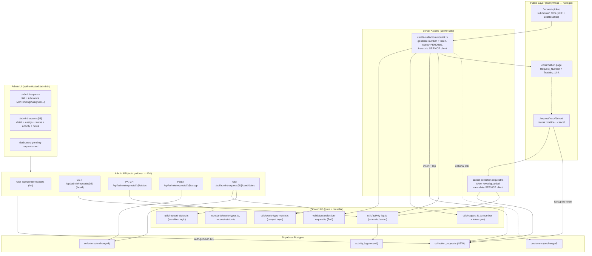
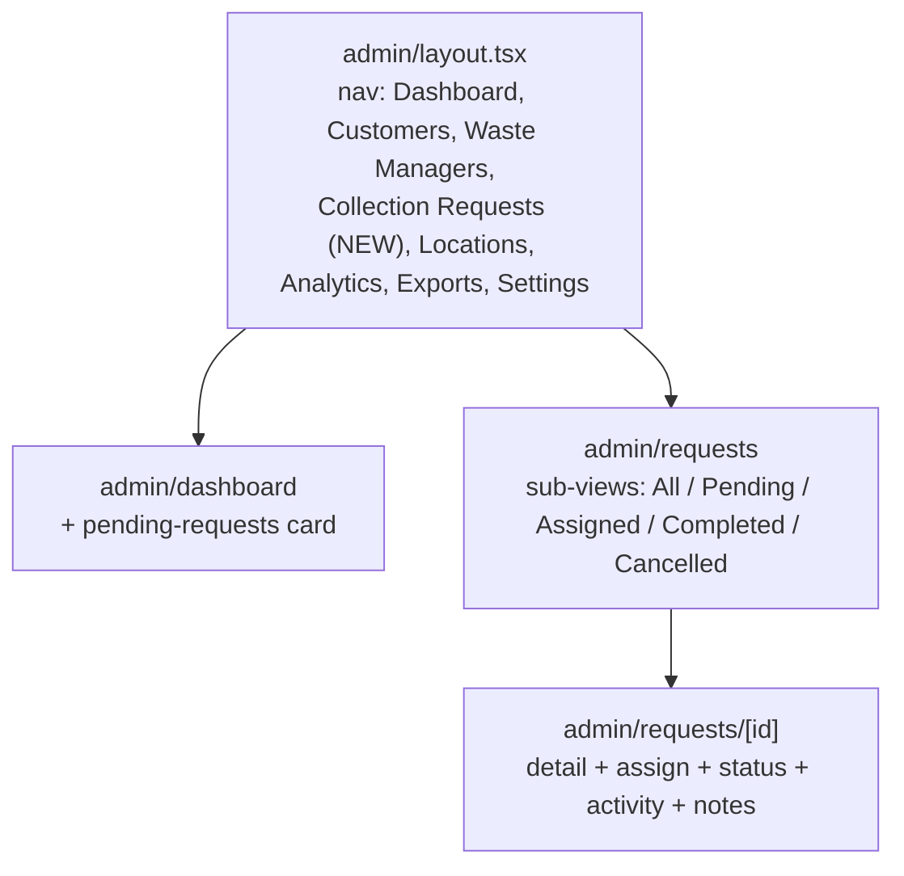
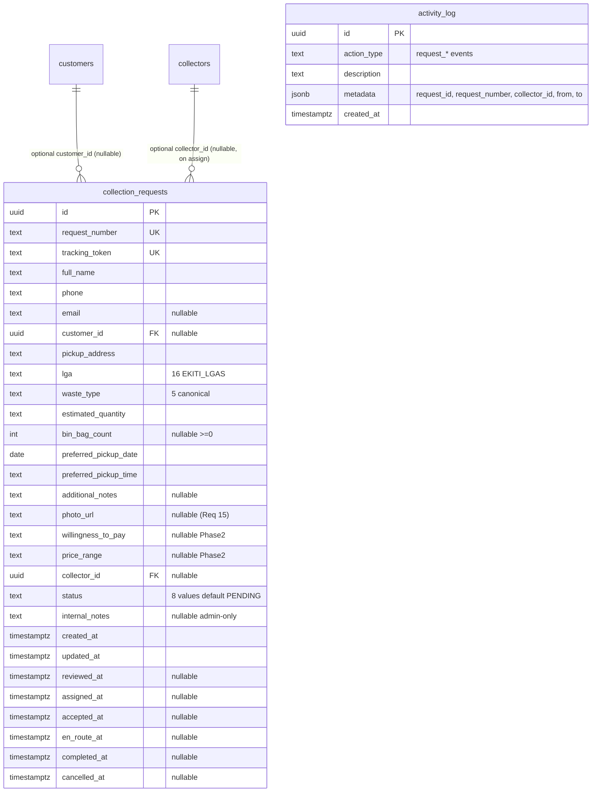

# Design Document: CleanCall Phase 3 — Collection Request Operational Workflow

## Overview

Phase 3 is an **additive, non-destructive extension** of the live CleanCall Phase 1 + Phase 2 application. It does not rebuild registration, admin auth, the admin console, the market-research capture, or the Activity_Log. Phase 3 layers the first **operational loop** on top of that foundation: a Public_Customer submits a Collection_Request through a public (anonymous) form, an Admin reviews and assigns it to a suitable Waste_Manager, and the Admin drives it through a controlled status lifecycle to completion. The Public_Customer tracks (and, while cancellable, cancels) the request through a secure token link with no account.

Phase 3 is deliberately **admin-mediated** (the stakeholder-chosen Option B, Requirement 18.2, 18.3): the only authenticated user is the single existing Admin. Collectors do not log in; the Admin performs assignment and every status transition on the Waste_Manager's behalf (Requirement 11.8).

Three principles drive every decision below, consistent with Phase 2:

1. **Backward compatibility (Requirement 1).** Existing tables, columns, and code identifiers are untouched; every new column on `collection_requests` that is not required is nullable; the new migration is additive and idempotent; existing records and existing tests keep passing.
2. **Reuse everything (Requirement 1.8, 16.2).** Phase 3 reuses the Supabase clients, `@supabase/ssr` auth, the `auth.getUser()` → `401` admin API pattern, the server-action + Zod + `ActionResult` pattern, the `as const` constants + barrel pattern, the `recordActivity` helper, the `displayField` null-safe display helper, the `terminology.ts` "Waste Manager" mapping, the `PaginatedResponse` list shape, the CSV utility, and the shadcn/ui + brand styling conventions.
3. **No new runtime dependencies.** Token generation uses the Node `crypto` module (built in on Node 22, `.nvmrc`). No package is added.

### One open decision (resolved): server action vs. API route for public submission

The public submission endpoint could be built either as a **server action** (like `register-customer.ts`, which uses the `anon` client) or as a public **API route**. This design **recommends a server action** (`create-collection-request.ts`) for consistency with the existing registration flow and because server actions run entirely server-side, letting the action own the whole insert payload.

The important nuance — and the security decision that follows in the Data Models section — is that the server action must **generate `request_number` and `tracking_token` server-side, set `status` to `PENDING` server-side, and never accept `status`, `collector_id`, or `internal_notes` from the client** (Requirement 14.5). Because the action controls the payload, and because Phase 3 inserts through the **service-role client** rather than the `anon` client, no client-supplied privileged column can reach the database. Public submission still works because the server action executes server-side.

### Provider_Status note (carried from Phase 2)

`Provider_Status` in this document refers to the existing Phase 2 `collectors.status` column (values in `PROVIDER_STATUSES`: `Pending`, `Contacted`, `Verified`, `Active`, `Inactive`, `Suspended`, `Rejected`). Phase 3 only reads it, and the value relevant to assignment eligibility (Requirement 10.1, 10.8) is **`Active`**.

## Architecture

Phase 3 preserves the Phase 1/Phase 2 layered architecture and adds a public request slice, an admin request slice, a shared pure-logic slice, and one new table.



**Auth model note (Requirement 14.1, 14.2).** Only the Admin is authenticated. Every admin API route repeats `createClient()` → `auth.getUser()` → `401` before any query, and the existing `src/lib/supabase/middleware.ts` route guard is extended to cover `/admin/requests/*`. The public routes are **anonymous**: submission runs server-side through a server action, and tracking/cancel are keyed **solely** by the `Tracking_Token` (Requirement 6, 7.5). Public routes never expose arbitrary rows — reads are single-row, token-keyed, via the service client.

**Activity logging (Requirement 13).** Every request lifecycle event routes through the existing `recordActivity(serviceClient, actionType, description, metadata)` helper, using the **service-role** client (the `activity_log` INSERT policy permits `service_role` only). Logging is best-effort and never fails the primary operation (Requirement 13.4 — the helper already swallows errors).

## Components and Interfaces

### New Constants (`src/lib/constants/`)

Each follows the verified `as const` + derived type + barrel export pattern (Requirement 1.8, 3.2).

| File | Export | Values |
|------|--------|--------|
| `waste-types.ts` | `WASTE_TYPES` | `HOUSEHOLD`, `COMMERCIAL`, `RECYCLABLE`, `CONSTRUCTION`, `MEDICAL` |
| `request-status.ts` | `REQUEST_STATUSES` | `PENDING`, `UNDER_REVIEW`, `ASSIGNED`, `ACCEPTED`, `EN_ROUTE`, `COMPLETED`, `CANCELLED`, `DISPUTED` |

```ts
// src/lib/constants/waste-types.ts
export const WASTE_TYPES = [
  'HOUSEHOLD',
  'COMMERCIAL',
  'RECYCLABLE',
  'CONSTRUCTION',
  'MEDICAL',
] as const;
export type WasteType = (typeof WASTE_TYPES)[number];
```

```ts
// src/lib/constants/request-status.ts
export const REQUEST_STATUSES = [
  'PENDING',
  'UNDER_REVIEW',
  'ASSIGNED',
  'ACCEPTED',
  'EN_ROUTE',
  'COMPLETED',
  'CANCELLED',
  'DISPUTED',
] as const;
export type RequestStatus = (typeof REQUEST_STATUSES)[number];
```

`src/lib/constants/index.ts` gains the two re-export blocks (constant + derived type), mirroring the existing barrel entries. Phase 2's `WILLINGNESS_TO_PAY` and `PRICE_RANGES` (already exported) are **reused verbatim** for the request price fields — the exact strings including `₦` and the en-dash must be reused so the DB CHECK constraints match (Requirement 2.8).

### Extended Activity Action Types (`src/lib/utils/activity-log.ts`)

The existing `ActivityActionType` TS union is **extended** (not replaced) with the Phase 3 request events, keeping the existing snake_case style (Requirement 13.1, 17.4). `action_type` remains plain `TEXT` in the DB, so no schema change is required to add these.

```ts
export type ActivityActionType =
  // Phase 2 (unchanged)
  | "admin_login"
  | "customer_status_change"
  | "provider_approval"
  | "provider_suspension"
  | "provider_status_change"
  | "data_export"
  // Phase 3 (new)
  | "request_created"
  | "request_reviewed"
  | "request_assigned"
  | "request_accepted"
  | "request_status_change"
  | "request_en_route"
  | "request_completed"
  | "request_cancelled"
  | "request_disputed";
```

The `recordActivity` signature and best-effort behavior are unchanged (Requirement 13.3, 13.4).

### Status Transition Logic (`src/lib/utils/request-status.ts`)

A **pure module** — no Supabase, no I/O — so it is fully unit/property testable and reused by both the status PATCH route and the assign route. It encodes the exact transition table from Requirement 4.3, treats `COMPLETED`/`CANCELLED` as terminal, allows `DISPUTED → CANCELLED`/`COMPLETED` (Requirement 4.4), forbids self-transition (Requirement 4.8), and never lists `ASSIGNED` as a generic-transition target (Requirement 4.5 — `ASSIGNED` is reached only via the assign operation).

```ts
import type { RequestStatus } from '@/lib/constants/request-status';

// ASSIGNED is intentionally NOT a value in any list here — it is reachable
// ONLY through the assignment operation (Requirement 4.5, 10.5).
export const ALLOWED_TRANSITIONS: Record<RequestStatus, readonly RequestStatus[]> = {
  PENDING:      ['UNDER_REVIEW', 'CANCELLED', 'DISPUTED'],
  UNDER_REVIEW: ['CANCELLED', 'DISPUTED'], // → ASSIGNED handled by assign op
  ASSIGNED:     ['ACCEPTED', 'CANCELLED', 'DISPUTED'],
  ACCEPTED:     ['EN_ROUTE', 'CANCELLED', 'DISPUTED'],
  EN_ROUTE:     ['COMPLETED', 'DISPUTED'],
  COMPLETED:    [],  // terminal
  CANCELLED:    [],  // terminal
  DISPUTED:     ['CANCELLED', 'COMPLETED'], // resolution
} as const;

/** True iff (from → to) is a permitted generic transition. Self-transition is never allowed. */
export function isAllowedTransition(from: RequestStatus, to: RequestStatus): boolean {
  if (from === to) return false;                       // Requirement 4.8
  return ALLOWED_TRANSITIONS[from].includes(to);       // Requirement 4.3, 4.7
}

/** The lifecycle timestamp column set when a request enters `status`, or null if none. */
export function timestampFieldForStatus(status: RequestStatus): string | null {
  switch (status) {
    case 'UNDER_REVIEW': return 'reviewed_at';
    case 'ASSIGNED':     return 'assigned_at';
    case 'ACCEPTED':     return 'accepted_at';
    case 'EN_ROUTE':     return 'en_route_at';
    case 'COMPLETED':    return 'completed_at';
    case 'CANCELLED':    return 'cancelled_at';
    default:             return null; // PENDING (created_at), DISPUTED (no dedicated ts)
  }
}

export const ASSIGNABLE_STATUSES: readonly RequestStatus[] = ['PENDING', 'UNDER_REVIEW'];
export const CANCELLABLE_STATUSES: readonly RequestStatus[] = ['PENDING', 'UNDER_REVIEW', 'ASSIGNED', 'ACCEPTED'];

export function isAssignable(status: RequestStatus): boolean {
  return ASSIGNABLE_STATUSES.includes(status);         // Requirement 10.4
}
export function isCancellable(status: RequestStatus): boolean {
  return CANCELLABLE_STATUSES.includes(status);        // Requirement 7.1, 7.2
}
```

The status PATCH route rejects transitions to `ASSIGNED` outright (only the assign op sets it), rejects self-transitions (Requirement 4.8), and rejects anything not in `ALLOWED_TRANSITIONS[from]` (Requirement 4.7).

### Waste-Type Compatibility Layer (`src/lib/utils/waste-type-match.ts`)

A **pure module** that relates a Collector's free-text `waste_types` values to the canonical `WasteType` set **without rewriting Collector data** (Requirement 3.3, 3.4, 3.5). It uses case-insensitive comparison plus a documented keyword/substring mapping table. A collector is compatible when **any** of their free-text waste-type entries maps to (or contains a keyword for) the requested canonical type, or names the canonical type directly.

Documented mapping table (canonical ← recognized keywords/synonyms, matched case-insensitively as substrings):

| Canonical `WasteType` | Recognized keywords / synonyms in free-text `waste_types` |
|-----------------------|-----------------------------------------------------------|
| `HOUSEHOLD` | `household`, `domestic`, `residential`, `general`, `general waste`, `municipal`, `organic`, `food` |
| `COMMERCIAL` | `commercial`, `business`, `office`, `market`, `general`, `general waste` |
| `RECYCLABLE` | `recycl`, `plastic`, `paper`, `cardboard`, `glass`, `metal`, `can`, `bottle` |
| `CONSTRUCTION` | `construction`, `demolition`, `rubble`, `debris`, `concrete`, `building` |
| `MEDICAL` | `medical`, `clinical`, `biohazard`, `hazardous`, `sharps`, `hospital` |

```ts
import type { WasteType } from '@/lib/constants/waste-types';

const KEYWORDS: Record<WasteType, readonly string[]> = {
  HOUSEHOLD:    ['household', 'domestic', 'residential', 'general', 'municipal', 'organic', 'food'],
  COMMERCIAL:   ['commercial', 'business', 'office', 'market', 'general'],
  RECYCLABLE:   ['recycl', 'plastic', 'paper', 'cardboard', 'glass', 'metal', 'can', 'bottle'],
  CONSTRUCTION: ['construction', 'demolition', 'rubble', 'debris', 'concrete', 'building'],
  MEDICAL:      ['medical', 'clinical', 'biohazard', 'hazardous', 'sharps', 'hospital'],
} as const;

/**
 * True iff any of the collector's free-text waste_types is compatible with the
 * requested canonical Waste_Type. Case-insensitive substring/keyword match; also
 * matches when the free-text value equals the canonical enum name directly.
 * Requirement 3.4, 3.5, 10.1.
 */
export function isCollectorWasteTypeCompatible(
  collectorWasteTypes: string[],
  canonical: WasteType
): boolean {
  const keywords = KEYWORDS[canonical];
  const canonicalLower = canonical.toLowerCase();
  return collectorWasteTypes.some((raw) => {
    const v = raw.trim().toLowerCase();
    if (v === canonicalLower) return true;
    return keywords.some((kw) => v.includes(kw));
  });
}
```

Note `general`/`general waste` maps to **both** `HOUSEHOLD` and `COMMERCIAL` (a general-waste collector serves both), matching the requested behavior. The mapping table is an internal implementation detail (Requirement 3.4 explicitly permits "an explicit mapping table").

### Request Number + Tracking Token Generators (`src/lib/utils/request-id.ts`)

Pure/deterministic where possible (number format depends on injected `now`), using Node `crypto` (no new dependency).

```ts
import { randomBytes, randomInt } from 'node:crypto';

/**
 * Human-friendly Request_Number: CR-YYYYMMDD-XXXX where XXXX is a 4-digit random
 * suffix. Uniqueness is enforced by the DB UNIQUE constraint plus retry-on-conflict
 * in the server action (Requirement 2.2, 5.5).
 */
export function generateRequestNumber(now: Date = new Date()): string {
  const y = now.getUTCFullYear();
  const m = String(now.getUTCMonth() + 1).padStart(2, '0');
  const d = String(now.getUTCDate()).padStart(2, '0');
  const suffix = String(randomInt(0, 10000)).padStart(4, '0');
  return `CR-${y}${m}${d}-${suffix}`;
}

/**
 * Unguessable, URL-safe Tracking_Token (~32 bytes of entropy, base64url). Not
 * derivable from the Request_Number (Requirement 2.3, glossary Tracking_Token).
 */
export function generateTrackingToken(): string {
  return randomBytes(32).toString('base64url');
}
```

**Token comparison note (Requirement 14.7).** Tracking lookups are performed as a direct `WHERE tracking_token = ?` equality via the service client. A single-row DB lookup by a unique, high-entropy token is the standard, acceptable approach and returns the one matching row or none. Requirement 14.7 asks for a constant-time comparison; because the token is unique and unguessable and we never branch on partial matches or reveal whether a `Request_Number` exists (Requirement 6.5), the DB equality lookup is acceptable. Where the code compares a supplied token against a stored token in application memory, it uses `crypto.timingSafeEqual` (equal-length buffers) to honor Requirement 14.7 explicitly. Not-found always yields the same generic not-found result (Requirement 6.5, 6.7).

### Validators (`src/lib/validators/collection-request.ts`)

A Zod schema for the public submission, following the existing validator pattern (infer input type). Reuses the Phase 1 Nigerian phone regex (Requirement 5.3), the `EKITI_LGAS` enum, the canonical `WASTE_TYPES` enum, and the Phase 2 `WILLINGNESS_TO_PAY` / `PRICE_RANGES` enums for the optional price fields.

```ts
import { z } from 'zod';
import { EKITI_LGAS } from '@/lib/constants/lgas';
import { WASTE_TYPES } from '@/lib/constants/waste-types';
import { WILLINGNESS_TO_PAY } from '@/lib/constants/willingness-to-pay';
import { PRICE_RANGES } from '@/lib/constants/price-ranges';

const NIGERIAN_PHONE = /^(0[7-9][01]\d{8}|\+234[7-9][01]\d{8})$/; // matches Phase 1

export const collectionRequestSchema = z.object({
  full_name: z.string().trim().min(1).max(100),
  phone: z.string().trim().regex(NIGERIAN_PHONE, 'Enter a valid Nigerian phone number'),
  email: z.string().trim().email().max(150).optional().or(z.literal('')),
  pickup_address: z.string().trim().min(1).max(255),
  lga: z.enum(EKITI_LGAS),
  waste_type: z.enum(WASTE_TYPES),
  estimated_quantity: z.string().trim().min(1).max(200),
  bin_bag_count: z.coerce.number().int().min(0).max(10000).optional(),
  preferred_pickup_date: z.string().refine(notInPast, 'Pickup date cannot be in the past'),
  preferred_pickup_time: z.string().trim().min(1).max(100),
  additional_notes: z.string().trim().max(1000).optional().or(z.literal('')),
  willingness_to_pay: z.enum(WILLINGNESS_TO_PAY).optional(),
  price_range: z.enum(PRICE_RANGES).optional(),
  // NOTE: status, collector_id, internal_notes, request_number, tracking_token,
  // photo_url and customer_id are NOT part of this schema — they are never
  // accepted from the client (Requirement 14.5).
});

export type CollectionRequestInput = z.infer<typeof collectionRequestSchema>;
```

The admin status-change payload gets a small schema too:

```ts
// src/lib/validators/request-status.ts
export const requestStatusChangeSchema = z.object({
  status: z.enum(REQUEST_STATUSES),
  fromExpected: z.enum(REQUEST_STATUSES).optional(), // optimistic-concurrency guard
});
export const assignRequestSchema = z.object({
  collector_id: z.string().uuid(),
});
```

### Admin API Routes

All follow the verified `createClient()` → `auth.getUser()` → `401` pattern; all privileged reads/writes and activity logs go through the appropriate client.

| Route | Method | Purpose | Requirements |
|-------|--------|---------|--------------|
| `/api/admin/requests` | GET | List: search (request_number/full_name/phone) + filters (status, lga, waste_type, date range, collector_id); `PaginatedResponse` | 8.2–8.6 |
| `/api/admin/requests/[id]` | GET | Detail (`maybeSingle` → 404) + related `activity_log` entries by `metadata.request_id` | 9.1–9.7 |
| `/api/admin/requests/[id]/status` | PATCH | Validate transition via `request-status` util; guarded update; set timestamp; log | 4.6–4.9, 11.1–11.7 |
| `/api/admin/requests/[id]/assign` | POST | Validate collector Active/exists; guarded atomic assign; set ASSIGNED + `assigned_at`; log | 10.1–10.8 |
| `/api/admin/requests/[id]/candidates` | GET | Suggested collectors (Active + service_area ∋ lga + waste-type compatible, ≤ 50) | 10.1, 10.2 |
| dashboard extension | GET | Pending count + recent request events (see below) | 12.1–12.3 |

**List route.** Mirrors `collectors/route.ts`: `.or(...ilike...)` for search over `request_number`, `full_name`, `phone`; `.eq('status', ...)`, `.eq('lga', ...)`, `.eq('waste_type', ...)`, `.eq('collector_id', ...)` applied only when the param is present; `.gte/.lte('created_at', ...)` for date range; `.order('created_at', { ascending: false })`; `.range(from, to)`; returns `PaginatedResponse<CollectionRequest>`. Combining search + filters yields the AND of all active conditions (Requirement 8.5).

**Detail route.** `select('*').eq('id', id).maybeSingle()` → `404` when null (Requirement 9.7). Then a second query fetches related activity: `activity_log` filtered by `metadata->>request_id = id` ordered `created_at DESC` (Requirement 9.5). Internal notes are included for the Admin (Requirement 9.6) but are never returned by any public route.

**Status PATCH — guarded update (Requirement 4.6, 4.7, 11.x).** The route loads the current status (or uses `fromExpected`), validates `isAllowedTransition(from, to)`, rejects `to === 'ASSIGNED'` (only the assign op sets it), then performs an optimistic guarded update so a concurrent change cannot be clobbered:

```ts
const nextTs = timestampFieldForStatus(to);            // e.g. 'accepted_at'
const patch: Record<string, unknown> = { status: to };
if (nextTs) patch[nextTs] = new Date().toISOString();

const { data, error } = await service
  .from('collection_requests')
  .update(patch)
  .eq('id', id)
  .eq('status', from)          // guard: only if still in the expected state
  .select()
  .maybeSingle();

if (!data) return NextResponse.json({ error: 'Transition no longer valid' }, { status: 400 });
// then: recordActivity(service, activityTypeForStatus(to), ..., { request_id, request_number, from, to })
```

Invalid transition → `400`, no change (Requirement 4.7, 4.8). Unauthenticated → `401` (Requirement 4.11, 14.2). Each transition logs the specific event type (`request_reviewed`, `request_accepted`, `request_en_route`, `request_completed`, `request_cancelled`, `request_disputed`) plus a generic `request_status_change` semantics captured in metadata `{ from, to }` (Requirement 11.3–11.7, 13.1, 13.2).

**Assign POST — guarded atomic update (Requirement 10.5, 10.7, 10.8).** First validate the collector exists and is `Active`:

```ts
const { data: collector } = await service
  .from('collectors').select('id, status').eq('id', collector_id).maybeSingle();
if (!collector || collector.status !== 'Active') {
  return NextResponse.json({ error: 'The selected Waste Manager is invalid' }, { status: 400 }); // Req 10.8
}
```

Then a single guarded atomic update that succeeds only when currently unassigned and in an assignable status:

```ts
const { data: rows } = await service
  .from('collection_requests')
  .update({ collector_id, status: 'ASSIGNED', assigned_at: new Date().toISOString() })
  .eq('id', id)
  .is('collector_id', null)               // guard: not already assigned
  .in('status', ['PENDING', 'UNDER_REVIEW']) // guard: assignable state
  .select();                               // returns [] when 0 rows matched

if (!rows || rows.length === 0) {
  return NextResponse.json(
    { error: 'This request is already assigned or not in an assignable state' },
    { status: 400 }                        // Req 10.7 — zero-row guard
  );
}
// recordActivity(service, 'request_assigned', ..., { request_id, request_number, collector_id })
```

Because the guard predicate (`collector_id IS NULL AND status IN (PENDING, UNDER_REVIEW)`) lives in the `WHERE` clause of a single statement, two concurrent assigns race at the database and exactly one wins; the loser matches zero rows and gets the `400` (Requirement 10.7). This is the concurrency-safe equivalent of Phase 1's unique-constraint race handling.

**Candidates route.** Loads `Active` collectors whose `service_areas` contains the request's LGA (`.contains('service_areas', [lga])`), then filters in memory by `isCollectorWasteTypeCompatible(waste_types, waste_type)`, caps at 50, and returns them (possibly empty — Requirement 10.2). The Admin may still assign any collector, including one not in this list (Requirement 10.3) — the candidates endpoint is only a suggestion.

**Dashboard extension (Requirement 12).** Add a `pendingRequests` count (derived at load: `collection_requests` where `status = 'PENDING'`, `count: 'exact', head: true`) and a `recentRequestEvents` list (recent `collection_requests` or `activity_log` request entries). Never hardcoded (Requirement 12.2).

### Admin UI Pages & Components



- **`src/app/admin/requests/page.tsx`** (client component): reuses `registration-table.tsx`, `search-filter-bar.tsx`, and the pagination pattern. It reads `?status=`, `?lga=`, `?waste_type=`, `?collector_id=`, `?dateFrom/dateTo`, `?search=` and fetches `/api/admin/requests`. Because it uses `useSearchParams`, it MUST be **wrapped in `<Suspense>`** (the verified Phase 2 build gotcha — carried forward). Columns: Request_Number, name, phone, LGA, Waste_Type, status badge, assigned Waste_Manager, created_at.
- **`src/app/admin/requests/[id]/page.tsx`**: detail sections (contact, pickup, scheduling, market fields, photo when present), a **status timeline** derived from lifecycle timestamps, an **assign control** (loads `/candidates`, allows arbitrary collector selection), a **status-change control** (reuses the `status-control.tsx` style; offers only `isAllowedTransition`-valid targets), **Activity_Log history** for the request, and an **internal-notes editor**. Null fields render via `displayField` → "Not recorded" (Requirement 9.3).
- **Nav extension (`layout.tsx`)**: add a **"Collection Requests"** top-level entry **between "Waste Managers" and "Locations"**, with sub-views mapping to `?status=` (`All`, `Pending`, `Assigned`, `Completed`, `Cancelled`). The `isSubViewActive` helper's "no-query = All" branch must be updated to also ignore the request filter params for the requests area.
- **Dashboard card**: a pending-requests count card wired to the dashboard route's `pendingRequests` value.

### Public UI Pages

- **`src/app/request-pickup/page.tsx`**: a mobile-first (usable from 320px, Requirement 16.3) form using React Hook Form + `zodResolver(collectionRequestSchema)` + native `<select>`/`<input>` with ARIA attributes and the brand palette/Inter font (Requirement 16.1). Fields per Requirement 2/5.2, including optional willingness-to-pay, price-range, and (deferred) photo. On submit it calls the `createCollectionRequest` server action. A note communicates that pricing/payment are future capabilities (Requirement 5.8).
- **Confirmation page**: shows the `Request_Number`, a summary, the current status (`PENDING`), and the `Tracking_Link` (`/request/track/{token}`) (Requirement 5.7).
- **`src/app/request/track/[token]/page.tsx`** (server component): looks up the request via the **service client** keyed by token, `notFound()` when missing (Requirement 6.5), renders the status timeline (Submitted → Under Review → Assigned → Accepted → En Route → Completed/Cancelled) and a minimal summary. It **never** renders `internal_notes` or any other row (Requirement 6.4). While the request is in a Cancellable_Status it shows a cancel control that requires a confirmation step (Requirement 7.3) and calls the `cancelCollectionRequest` token-keyed server action.
- **Landing-page CTA (optional/minimal, Requirement 5.1)**: a "Request a Pickup" link to `/request-pickup` MAY be added to `src/app/page.tsx`. Mentioned for completeness; kept minimal.

### Public Server Actions

**`src/lib/actions/create-collection-request.ts`** (`"use server"`): parse `FormData`, `collectionRequestSchema.safeParse` → `fieldErrors` on failure (Requirement 5.4, 14.8); generate `request_number` + `tracking_token`; set `status = 'PENDING'`, `created_at`; insert via the **service client**; on unique-violation (`23505`) for `request_number`, regenerate and retry (bounded retries, Requirement 5.5); `recordActivity(service, 'request_created', ..., { request_id, request_number })` (Requirement 5.6); return `ActionResult` extended with `request_number` + `tracking_token` (or redirect to the confirmation page). It never reads `status`, `collector_id`, or `internal_notes` from the form (Requirement 14.5).

**`src/lib/actions/cancel-collection-request.ts`** (`"use server"`): keyed by `token`; loads the row by token via the service client; if `isCancellable(status)` is false → return a blocked result (the route responds `400`, Requirement 7.2); otherwise a guarded update `set status='CANCELLED', cancelled_at=now() where tracking_token=? and status in CANCELLABLE_STATUSES`; `recordActivity(service, 'request_cancelled', ..., { request_id, request_number, from })` (Requirement 7.4). Authorization is solely the token (Requirement 7.5, 14.10).

## Data Models

### Migration `003_phase3_collection_requests.sql` (additive, idempotent)

The migration only **adds** — no `DROP`, `RENAME`, `TRUNCATE`, `ALTER COLUMN ... TYPE`, or `DELETE` — and uses `IF NOT EXISTS` throughout so re-applying it is a no-op (Requirement 1.1, 1.6). It creates one new table and reuses the Phase 2 `set_updated_at()` function (which already exists; only a new trigger is created here).

```sql
-- 003_phase3_collection_requests.sql
-- CleanCall Phase 3 — Collection Request Operational Workflow.
-- Additive and idempotent. Creates collection_requests; reuses the existing
-- activity_log table and the Phase 2 set_updated_at() trigger function.

-- ============================================================
-- TABLE
-- ============================================================
CREATE TABLE IF NOT EXISTS collection_requests (
    id UUID PRIMARY KEY DEFAULT gen_random_uuid(),

    -- Identity
    request_number TEXT NOT NULL UNIQUE,          -- CR-YYYYMMDD-XXXX (Req 2.2)
    tracking_token TEXT NOT NULL UNIQUE,          -- unguessable (Req 2.3)

    -- Contact (captured on the request itself; Req 2.4)
    full_name TEXT NOT NULL CHECK (char_length(full_name) BETWEEN 1 AND 100),
    phone TEXT NOT NULL CHECK (phone ~ '^(0[7-9][01]\d{8}|\+234[7-9][01]\d{8})$'),
    email TEXT CHECK (email IS NULL OR email ~ '^[^@]+@[^@]+\.[^@]+$'),

    -- Optional link to an existing customer (Req 2.5, 17.1)
    customer_id UUID NULL REFERENCES customers(id),

    -- Pickup (Req 2.6)
    pickup_address TEXT NOT NULL CHECK (char_length(pickup_address) BETWEEN 1 AND 255),
    lga TEXT NOT NULL CHECK (lga IN (
        'Ado-Ekiti', 'Ikere', 'Oye', 'Ikole', 'Ekiti East',
        'Ekiti West', 'Emure', 'Ise/Orun', 'Irepodun/Ifelodun',
        'Ijero', 'Efon', 'Ekiti South-West', 'Gbonyin',
        'Ido-Osi', 'Moba', 'Ilejemeje'
    )),
    waste_type TEXT NOT NULL CHECK (waste_type IN (
        'HOUSEHOLD', 'COMMERCIAL', 'RECYCLABLE', 'CONSTRUCTION', 'MEDICAL'
    )),
    estimated_quantity TEXT NOT NULL CHECK (char_length(estimated_quantity) BETWEEN 1 AND 200),
    bin_bag_count INTEGER NULL CHECK (bin_bag_count IS NULL OR bin_bag_count >= 0),

    -- Scheduling (Req 2.7)
    preferred_pickup_date DATE NOT NULL,
    preferred_pickup_time TEXT NOT NULL CHECK (char_length(preferred_pickup_time) BETWEEN 1 AND 100),

    -- Optional details (Req 2.8, 15.1)
    additional_notes TEXT NULL,
    photo_url TEXT NULL,
    willingness_to_pay TEXT NULL
        CHECK (willingness_to_pay IN ('Yes', 'Maybe - Depends on price', 'No')),
    price_range TEXT NULL
        CHECK (price_range IN ('Below ₦2,000', '₦2,000–₦5,000', '₦5,000–₦10,000', 'Above ₦10,000', 'Not sure')),

    -- Assignment (Req 2.9) — set only on assignment
    collector_id UUID NULL REFERENCES collectors(id),

    -- Lifecycle (Req 2.10, 4.1, 4.2)
    status TEXT NOT NULL DEFAULT 'PENDING' CHECK (status IN (
        'PENDING', 'UNDER_REVIEW', 'ASSIGNED', 'ACCEPTED',
        'EN_ROUTE', 'COMPLETED', 'CANCELLED', 'DISPUTED'
    )),
    internal_notes TEXT NULL,                     -- Admin-only (Req 2.11, 9.6)

    -- Timestamps (Req 2.10) — set only when the transition occurs
    created_at   TIMESTAMPTZ NOT NULL DEFAULT now(),
    updated_at   TIMESTAMPTZ NOT NULL DEFAULT now(),
    reviewed_at  TIMESTAMPTZ NULL,
    assigned_at  TIMESTAMPTZ NULL,
    accepted_at  TIMESTAMPTZ NULL,
    en_route_at  TIMESTAMPTZ NULL,
    completed_at TIMESTAMPTZ NULL,
    cancelled_at TIMESTAMPTZ NULL
);

-- ============================================================
-- INDEXES (idempotent)
-- ============================================================
CREATE INDEX IF NOT EXISTS idx_requests_status         ON collection_requests(status);
CREATE INDEX IF NOT EXISTS idx_requests_collector_id   ON collection_requests(collector_id);
CREATE INDEX IF NOT EXISTS idx_requests_customer_id    ON collection_requests(customer_id);
CREATE INDEX IF NOT EXISTS idx_requests_lga            ON collection_requests(lga);
CREATE INDEX IF NOT EXISTS idx_requests_waste_type     ON collection_requests(waste_type);
CREATE INDEX IF NOT EXISTS idx_requests_pickup_date    ON collection_requests(preferred_pickup_date);
CREATE INDEX IF NOT EXISTS idx_requests_created_at     ON collection_requests(created_at DESC);
-- request_number and tracking_token UNIQUE constraints already create indexes.

-- Search over the admin-searchable text columns (Req 8.3).
CREATE INDEX IF NOT EXISTS idx_requests_search ON collection_requests USING GIN(
    to_tsvector('english', request_number || ' ' || full_name || ' ' || phone)
);

-- ============================================================
-- updated_at TRIGGER (reuses the Phase 2 set_updated_at() function; Req 2.10)
-- ============================================================
-- set_updated_at() already exists from migration 002; do not redefine it.
DROP TRIGGER IF EXISTS trg_requests_updated_at ON collection_requests;
CREATE TRIGGER trg_requests_updated_at
    BEFORE UPDATE ON collection_requests
    FOR EACH ROW EXECUTE FUNCTION set_updated_at();

-- ============================================================
-- ROW LEVEL SECURITY (Req 14.3, 14.4, 14.5, 14.6)
-- ============================================================
ALTER TABLE collection_requests ENABLE ROW LEVEL SECURITY;

-- Admins (any authenticated session) may read and update any row.
CREATE POLICY "Admin select requests" ON collection_requests
    FOR SELECT TO authenticated USING (true);
CREATE POLICY "Admin update requests" ON collection_requests
    FOR UPDATE TO authenticated USING (true) WITH CHECK (true);

-- All privileged reads/writes (public submission insert, token-keyed tracking
-- reads, token-keyed cancel updates, and admin mutations) run server-side via
-- the SERVICE-ROLE client, which bypasses RLS.
CREATE POLICY "Service manage requests" ON collection_requests
    FOR ALL TO service_role USING (true) WITH CHECK (true);

-- Intentionally NO anon policy: the anon role cannot touch collection_requests.
```

**RLS decision — insert via service role, not anon (important; Requirement 14.3–14.6).** The registration tables use an `anon INSERT WITH CHECK (true)` policy. A naive port of that to `collection_requests` would let an anonymous insert set the **privileged columns** (`status`, `collector_id`, `internal_notes`, `tracking_token`, `request_number`) because `WITH CHECK (true)` places no column restriction — exactly the hole Requirement 14.5 warns against.

This design closes that hole by **performing the public insert through the service-role client inside the `create-collection-request` server action** rather than through the `anon` client. Consequently:

- There is **no anon policy at all** on `collection_requests` — the anon role can neither insert nor select (satisfying Requirement 14.4's "anon MAY NOT select" and going further by also denying anon insert).
- The server action **owns the entire insert payload**, so the client physically cannot supply `status`/`collector_id`/`internal_notes`/tokens — they are set server-side (Requirement 14.5).
- Public submission still works because the server action runs server-side with the service client (Requirement 5.1, 5.5).
- Tracking and cancel also run server-side via the service client keyed by token (Requirement 6.3, 6.6, 7.5).

**Tradeoff vs. the registration pattern.** Registration accepted an `anon` insert because its tables have no privileged columns to protect and the anon path is simpler. Phase 3 has privileged columns and a token that must be server-generated, so the tighter **service-role-insert-via-server-action** approach is preferred. The requirements text (14.3) mentions an "anonymous INSERT governed by RLS"; this design satisfies the *intent* — public, unauthenticated submission that cannot set privileged columns and cannot read other rows — with a cleaner mechanism, and documents the deviation here for the reviewer. If the stakeholder insists on a literal anon-insert policy, the fallback is an `anon INSERT` policy plus a `BEFORE INSERT` trigger that force-overwrites the privileged columns to their defaults; the service-role approach avoids needing that trigger.

### Entity Relationship Diagram



`collection_requests` relates to `activity_log` only loosely, through `metadata.request_id` (JSONB) — no hard FK, consistent with the Phase 2 open-ended event model (Requirement 17.4). The nullable `customer_id`/`collector_id` FKs mean one Customer and one Collector can each be referenced by many requests, and neither key permanently couples a Customer to a single Collector (Requirement 2.13, 17.1, 17.2).

### TypeScript Type Additions (`src/types/index.ts`)

```ts
import type { WasteType } from '@/lib/constants/waste-types';
import type { RequestStatus } from '@/lib/constants/request-status';
import type { WillingnessToPay, PriceRange } from '@/types'; // existing

export type { WasteType, RequestStatus };

/** Full DB row. */
export interface CollectionRequest {
  id: string;
  request_number: string;
  tracking_token: string;
  full_name: string;
  phone: string;
  email: string | null;
  customer_id: string | null;
  pickup_address: string;
  lga: string;
  waste_type: WasteType;
  estimated_quantity: string;
  bin_bag_count: number | null;
  preferred_pickup_date: string;
  preferred_pickup_time: string;
  additional_notes: string | null;
  photo_url: string | null;
  willingness_to_pay: WillingnessToPay | null;
  price_range: PriceRange | null;
  collector_id: string | null;
  status: RequestStatus;
  internal_notes: string | null;
  created_at: string;
  updated_at: string;
  reviewed_at: string | null;
  assigned_at: string | null;
  accepted_at: string | null;
  en_route_at: string | null;
  completed_at: string | null;
  cancelled_at: string | null;
}

/** Validated public submission input (no privileged columns). */
export interface CollectionRequestInput {
  full_name: string;
  phone: string;
  email?: string;
  pickup_address: string;
  lga: string;
  waste_type: WasteType;
  estimated_quantity: string;
  bin_bag_count?: number;
  preferred_pickup_date: string;
  preferred_pickup_time: string;
  additional_notes?: string;
  willingness_to_pay?: WillingnessToPay;
  price_range?: PriceRange;
}

/** A suggested collector for the assign control. */
export interface CandidateCollector {
  id: string;
  business_name: string;
  service_areas: string[];
  waste_types: string[];
  status: string; // Provider_Status; candidates are Active only
}

/** The public-safe projection returned to the tracking view (no internal_notes/token). */
export interface PublicRequestView {
  request_number: string;
  status: RequestStatus;
  lga: string;
  waste_type: WasteType;
  preferred_pickup_date: string;
  preferred_pickup_time: string;
  created_at: string;
  reviewed_at: string | null;
  assigned_at: string | null;
  accepted_at: string | null;
  en_route_at: string | null;
  completed_at: string | null;
  cancelled_at: string | null;
}
```

`ActionResult` is extended (optionally) to carry `request_number` and `tracking_token` on success for the confirmation page.

### Migration Safety and Rollout Procedure

Migration `003` is **purely additive** — it creates one new table and one new trigger and touches **no existing table's data** — so it is far lower-risk than Phase 2's `002`. It is nonetheless validated through the same gated procedure used for Phase 2 (reference the Phase 2 runbook):

1. **Capture a recovery point / backup first** (`pg_dump` via the `postgres:17` docker image, matching the Phase 2 backup approach) and record it as the documented restore target.
2. **Apply and validate on staging first** (never production first). Apply `003` and confirm the new table, indexes, trigger, and RLS policies exist.
3. **Before-and-after verification.** Assert `SELECT count(*)` on `customers`, `collectors`, `login_attempts`, and `activity_log` is **unchanged** across the migration (Requirement 1.5) and spot-check sample existing values are byte-for-byte unchanged (Requirement 1.1).
4. **Additive-only reviewer checklist.** Confirm `003` contains only `CREATE TABLE IF NOT EXISTS`, `CREATE INDEX IF NOT EXISTS`, `CREATE POLICY`, `CREATE TRIGGER`, `ALTER TABLE ... ENABLE ROW LEVEL SECURITY` — no `DROP`/`RENAME`/`TRUNCATE`/`ALTER COLUMN ... TYPE`/`DELETE`.
5. **Idempotency check.** Apply `003` twice on staging; the second apply must succeed with no error and the same resulting schema (Requirement 1.6).
6. **Transactional apply.** Apply within a transaction (`psql --single-transaction`) so a partial failure rolls back cleanly.
7. **Production apply only after staging passes and explicit stakeholder approval** (hard approval gate — code may be developed against staging in parallel, but production data is modified only after approval).

## Correctness Properties

*A property is a characteristic or behavior that should hold true across all valid executions of a system—essentially, a formal statement about what the system should do. Properties serve as the bridge between human-readable specifications and machine-verifiable correctness guarantees.*

The properties below target Phase 3's **pure logic**: the status transition module, the waste-type compatibility layer, the request-number/token generators, the submission validators, the admin filter predicate, and the public-view projection. Behavior that depends on Supabase, auth `401`s, RLS, the `updated_at` trigger, activity-log inserts, and the concurrent assignment race is covered by integration tests in the Testing Strategy, not by these properties.

### Property 1: Allowed transitions match the exact table

*For any* pair of Request_Status values `(from, to)`, `isAllowedTransition(from, to)` SHALL return true if and only if `(from → to)` is one of the sixteen permitted transitions in Requirement 4.3; in particular the allowed set from `DISPUTED` SHALL be exactly `{CANCELLED, COMPLETED}`, and the allowed sets from `COMPLETED` and from `CANCELLED` SHALL be empty.

**Validates: Requirements 4.3, 4.4, 4.7**

### Property 2: Self-transition is never allowed

*For any* Request_Status value `s`, `isAllowedTransition(s, s)` SHALL return false.

**Validates: Requirements 4.8**

### Property 3: Lifecycle timestamp mapping is exact

*For any* Request_Status value, `timestampFieldForStatus` SHALL return `reviewed_at` for `UNDER_REVIEW`, `assigned_at` for `ASSIGNED`, `accepted_at` for `ACCEPTED`, `en_route_at` for `EN_ROUTE`, `completed_at` for `COMPLETED`, `cancelled_at` for `CANCELLED`, and null for `PENDING` and `DISPUTED`; and `ALLOWED_TRANSITIONS` SHALL never list `ASSIGNED` as a transition target.

**Validates: Requirements 4.5, 4.6, 2.10**

### Property 4: Waste-type compatibility is sound

*For any* canonical Waste_Type `C`: (a) a collector whose `waste_types` list contains the exact canonical string in any letter case SHALL be compatible with `C`; (b) a collector whose `waste_types` list contains any documented keyword for `C` SHALL be compatible with `C`; and (c) a collector all of whose `waste_types` entries contain none of `C`'s documented keywords and do not name `C` SHALL NOT be compatible with `C`.

**Validates: Requirements 3.4, 3.5, 10.1**

### Property 5: Request_Number format encodes the date

*For any* date, `generateRequestNumber(date)` SHALL match the pattern `CR-YYYYMMDD-XXXX` (a `CR-` prefix, an 8-digit date, a dash, and a 4-digit numeric suffix), and the `YYYYMMDD` segment SHALL equal the UTC year, month, and day of the supplied date.

**Validates: Requirements 2.2, 5.5**

### Property 6: Tracking_Token is URL-safe and collision-free

*For any* set of generated Tracking_Tokens, each token SHALL consist only of URL-safe base64url characters (`A–Z`, `a–z`, `0–9`, `-`, `_`), SHALL have the fixed length produced by 32 random bytes, and any set of distinctly generated tokens SHALL contain no duplicates.

**Validates: Requirements 2.3, 6.5**

### Property 7: Assignable guard is exact

*For any* Request_Status value, `isAssignable(status)` SHALL return true if and only if the status is `PENDING` or `UNDER_REVIEW`.

**Validates: Requirements 10.4, 10.5, 10.7**

### Property 8: Cancellable guard is exact

*For any* Request_Status value, `isCancellable(status)` SHALL return true if and only if the status is `PENDING`, `UNDER_REVIEW`, `ASSIGNED`, or `ACCEPTED`, and SHALL return false for `EN_ROUTE`, `COMPLETED`, `CANCELLED`, and `DISPUTED`.

**Validates: Requirements 7.1, 7.2**

### Property 9: Admin list filter soundness

*For any* collection-request dataset and *any* combination of active filters (search over request_number/full_name/phone, status, LGA, Waste_Type, assigned collector, and preferred/created date range), every request in the filtered result SHALL satisfy **all** active conditions simultaneously, and a request with a null value for a filtered field SHALL be excluded only when that filter specifies a non-null value.

**Validates: Requirements 8.2, 8.4, 8.5**

### Property 10: Canonical Waste_Type validation is exact

*For any* string value, the submission schema's `waste_type` field SHALL validate successfully if and only if the value is one of `HOUSEHOLD`, `COMMERCIAL`, `RECYCLABLE`, `CONSTRUCTION`, or `MEDICAL`.

**Validates: Requirements 3.1, 5.3**

### Property 11: Public view never exposes privileged fields

*For any* Collection_Request row, the public tracking projection SHALL omit `internal_notes`, `tracking_token`, and `collector_id`, SHALL include only the whitelisted timeline and summary fields, and SHALL NOT raise an error for any field value including nulls.

**Validates: Requirements 6.4, 9.6**

### Property 12: Preferred pickup date rejects the past

*For any* calendar date strictly before the current date, the submission schema SHALL reject `preferred_pickup_date`; and *for any* date equal to or after the current date (with all other fields valid), the schema SHALL accept it.

**Validates: Requirements 5.3, 5.4**

## Error Handling

Phase 3 preserves the Phase 1/Phase 2 error conventions:

- **Unauthenticated admin API access** (Requirements 8.6, 14.2, 4.11): every admin request route runs `auth.getUser()` first and returns `{ error: "Unauthorized" }` with status `401` and no request data before any query executes; the middleware redirects unauthenticated admin **page** navigation to the login page (Requirement 14.1).
- **Invalid submission / PATCH payloads** (Requirements 5.4, 14.8): `safeParse` failure returns `400` with a `fieldErrors` map derived from `parsed.error.issues` (same shape as the Phase 1 registration actions), and nothing is persisted (Requirement 5.4).
- **Invalid status transition** (Requirements 4.7, 4.8): a transition not in `ALLOWED_TRANSITIONS[from]`, a self-transition, or a target of `ASSIGNED` returns `400` with no change to status or timestamps.
- **Assignment guard failures** (Requirements 10.7, 10.8): an invalid/inactive collector → `400` "selected Waste Manager is invalid"; a zero-row guarded update (already assigned or not assignable) → `400` "already assigned or not in an assignable state"; the stored `collector_id`/status are left unchanged.
- **Cancellation guard failure** (Requirement 7.2): a cancel on a non-cancellable status → `400` with no change.
- **Not-found detail / tracking** (Requirements 6.5, 9.7): unknown admin id → not-found (`404` / `notFound()`); unknown or non-matching Tracking_Token → the same generic not-found result, never revealing whether a Request_Number exists.
- **Database errors** (Requirement 14.9): return `500` with the generic message `"An unexpected error occurred. Please try again."`, never leaking raw DB errors, stack traces, or SQL.
- **Request_Number collision** (Requirement 5.5): a `23505` unique violation on `request_number` triggers bounded regeneration-and-retry inside the server action; the DB unique constraint is the source of truth.
- **Activity-log write failures** (Requirement 13.4): swallowed by `recordActivity`, never failing the primary operation.

## Requirements Traceability

Every Phase 3 design item maps to Requirements 1–18: backward-compatibility and the additive/idempotent migration (Requirement 1); the `collection_requests` table and its columns (Requirement 2); canonical Waste_Type constants and the compatibility layer (Requirement 3); the status transition module (Requirement 4); the public submission server action, validator, and confirmation page (Requirement 5); token-keyed public tracking (Requirement 6); token-keyed public cancellation (Requirement 7); the admin list route/UI (Requirement 8); the admin detail page (Requirement 9); the guarded assign route + candidates (Requirement 10); admin status management (Requirement 11); the dashboard pending count and recent events (Requirement 12); request activity logging via the extended union and service client (Requirement 13); security/authorization including the service-role-insert RLS decision, Zod validation, generic errors, env secrets, and deferred rate limiting (Requirement 14); the nullable `photo_url` foundation (Requirement 15); brand/responsiveness (Requirement 16); future-phase compatibility via nullable FKs, explicit status/timestamps, and generic activity types (Requirement 17); and the explicitly deferred capabilities (Requirement 18).

**Internal-only implementation details** (no direct acceptance criterion; chosen purely to satisfy the requirements above):

- **The Request_Number and Tracking_Token generators** (`request-id.ts`) — a means to satisfy Requirements 2.2/2.3/5.5; the exact suffix scheme and 32-byte base64url token are internal decisions.
- **The waste-type mapping table** (`waste-type-match.ts`) — a means to satisfy Requirement 3.4/3.5; Requirement 3.4 explicitly permits "an explicit mapping table," so the specific keyword lists are internal.
- **The status transition module** (`request-status.ts` — `ALLOWED_TRANSITIONS`, `isAllowedTransition`, `timestampFieldForStatus`, the assignable/cancellable predicates) — a means to encode Requirement 4/7/10 as testable pure logic; the module shape is an internal decision.
- **The service-role-insert-via-server-action RLS decision** — a means to satisfy Requirements 14.4/14.5 (anon cannot select; client cannot set privileged columns) more tightly than an anon-insert policy; the mechanism is an internal decision documented under Data Models and Risks.
- **The `PublicRequestView` projection** — a means to satisfy Requirement 6.4 (no internal notes/other data on tracking); the exact whitelist is an internal decision.

No design item introduces scope outside Requirements 1–18. Requirement 11's clause "2a" (DISPUTED resolution) is treated as ordinary prose and folded into the transition table (Property 1).

## Risks and Assumptions

- **(a) RLS: service-role insert vs. anon insert.** *Assumption:* performing the public insert through the service-role client inside the server action (with no anon policy on `collection_requests`) is acceptable and is tighter than the registration anon-insert pattern, because it closes the privileged-column hole (Requirement 14.5) and denies anon `SELECT` (Requirement 14.4). Documented tradeoff and literal-anon-insert fallback (BEFORE INSERT trigger) are in Data Models.
- **(b) Request_Number collision.** *Assumption:* the `CR-YYYYMMDD-XXXX` 4-digit random suffix plus the DB `UNIQUE` constraint and bounded retry-on-`23505` is sufficient volume-wise for Phase 3; if daily volume ever approaches the 10,000-suffix space, the suffix width can be widened without a schema change beyond the constraint.
- **(c) Photo upload deferred.** No Supabase Storage bucket is configured; `photo_url` is a nullable column only, and actual upload is out of scope (Requirement 15.3). No AI/image analysis (Requirement 15.4).
- **(d) Notifications are in-app only.** The dashboard pending count and recent events are derived at load time; no email/push/third-party infrastructure is added (Requirement 12.4).
- **(e) Admin acts on the collector's behalf.** ACCEPTED, EN_ROUTE, and COMPLETED transitions are performed by the Admin representing real-world progress; there is no collector login (Requirements 11.8, 18.2, 18.3).
- **(f) Reassignment.** *Assumption:* Phase 3 does **not** support reassigning an already-assigned request through the guarded assign path (the guard requires `collector_id IS NULL`). Assignment mistakes are handled through the DISPUTED/CANCELLED lifecycle (e.g. dispute then re-submit, or cancel) rather than by mutating `collector_id` on an assigned request. This keeps assignment atomic and auditable; a dedicated reassignment operation is deferred to a later phase.
- **(g) "authenticated == admin" posture.** Phase 3 introduces no non-admin login path, so the Phase 2 posture (any authenticated Supabase session is the Admin) remains valid. The Phase 2 hard precondition still applies: before any future non-admin login is enabled, the `authenticated USING (true)` policies (including the new `collection_requests` ones) MUST be tightened to role/claim-scoped policies.

## Testing Strategy

Phase 3 uses the existing stack: **vitest**, **fast-check** (property-based), and **@testing-library/react**, with tests under `tests/{unit,properties,integration}` on **Node 22**. No new testing dependency is added.

### Dual Testing Approach

- **Unit tests** cover concrete examples, edge cases, and error conditions.
- **Property-based tests** cover the twelve universal properties above.
- Both are complementary and both are required.

### Property-Based Tests

PBT **is appropriate** for Phase 3 because its core logic layer is pure functions: the status transition table and predicates, the waste-type compatibility matcher, the Request_Number/Tracking_Token generators, the Zod validators, the admin filter predicate, and the public-view projection — all with clear input/output behavior and large input spaces.

Requirements:
- Use **fast-check** (already installed). Do not hand-roll property testing.
- Each property test runs a **minimum of 100 iterations** (`{ numRuns: 100 }` or higher).
- Each property test is tagged with a comment referencing its design property, format: **Feature: cleancall-phase-3-collection-requests, Property {number}: {property_text}**.
- Each of Properties 1–12 is implemented by a **single** property-based test.
- Generators (`fc.constantFrom` over `REQUEST_STATUSES`/`WASTE_TYPES`, `fc.record`, `fc.option` for nullable fields, `fc.date`, random free-text `waste_types` arrays) MUST include null/empty/no-match/boundary cases so edge cases are exercised by the generators.

Tests target the extracted pure helpers (`isAllowedTransition`, `timestampFieldForStatus`, `isAssignable`, `isCancellable`, `isCollectorWasteTypeCompatible`, `generateRequestNumber`, `generateTrackingToken`, `collectionRequestSchema`, `filterRequests`, `toPublicView`) so properties test logic independently of Supabase.

### Unit Tests

- **Validators**: `collectionRequestSchema` accepts a fully-valid submission; rejects bad phone, invalid LGA, invalid waste type, empty required fields, and past pickup date with the correct `fieldErrors`.
- **Status util**: `ALLOWED_TRANSITIONS` snapshot; representative allowed/blocked transitions; `to === 'ASSIGNED'` rejection path.
- **Waste-match**: representative synonyms (`General Waste` → HOUSEHOLD & COMMERCIAL, `Recyclables` → RECYCLABLE, `Medical/Clinical` → MEDICAL) and a clearly-incompatible example.
- **Generators**: `generateRequestNumber` example for a fixed date; `generateTrackingToken` charset/length example.
- **Display**: `displayField` reuse for null request fields → "Not recorded".

### Integration Tests (mocked Supabase, mirroring the Phase 2 `api-phase2.test.ts` style)

- **Public submission**: happy path stores a request with server-generated number/token and `status = PENDING`, and logs `request_created`; invalid payload → `400` + `fieldErrors`, nothing stored (Requirements 5.4, 5.5, 5.6).
- **Tracking by token**: found → returns the public view (no `internal_notes`); unknown token → generic not-found (Requirements 6.2, 6.4, 6.5).
- **Cancel**: cancellable status → `CANCELLED` + `cancelled_at` + `request_cancelled` log; non-cancellable (EN_ROUTE/COMPLETED/CANCELLED/DISPUTED) → `400`, unchanged (Requirements 7.2, 7.4).
- **Admin list**: `401` unauthenticated + no data (Requirement 8.6); seeded data returns only rows matching each filter and combined search+filter (Requirement 8.5).
- **Admin detail**: returns the record incl. internal notes + related activity; unknown id → not-found (Requirements 9.5, 9.6, 9.7).
- **Status PATCH**: valid transition → `200`, status + timestamp set, correct activity type; invalid/self/`ASSIGNED` transition → `400`, unchanged (Requirements 4.6, 4.7, 4.8, 11.3–11.7).
- **Assign**: success sets `collector_id` + `ASSIGNED` + `assigned_at` + `request_assigned` log; invalid/inactive collector → `400` (Requirement 10.8); **double-assign race** — two concurrent assigns, exactly one succeeds and the other gets `400` already-assigned (Requirement 10.7). This concurrency test is explicit and required.
- **Candidates**: returns only Active + service-area-matching + waste-compatible collectors, capped at 50, empty when none (Requirements 10.1, 10.2).
- **Activity logging**: each operation calls `recordActivity` with the correct `action_type` and metadata (`request_id`, `request_number`, and where relevant `collector_id`, `from`, `to`), through the service client (Requirements 13.1, 13.2, 13.3).

### Migration / Schema Checks (staging-gated, like Phase 2's `migration.test.ts`)

- `collection_requests` exists with the expected columns, CHECK constraints, `UNIQUE` on `request_number`/`tracking_token`, indexes, the `updated_at` trigger, and the three RLS policies (authenticated SELECT/UPDATE, service_role ALL, no anon).
- Applying `003` twice is a no-op (idempotency, Requirement 1.6).
- `count(*)` on `customers`/`collectors`/`login_attempts`/`activity_log` is unchanged across the migration (Requirement 1.5).

### Regression

The Phase 1 and Phase 2 test suites MUST stay green after Phase 3, and `next build` MUST succeed (Requirements 1.3, 1.4, 1.7). New optional fields, the new table, and extended nav/props MUST NOT alter existing behavior. Client components using `useSearchParams` (the requests list) MUST be `<Suspense>`-wrapped to avoid the Phase 2 prerender bailout. Run the full existing suite (`npm run test`) and `npm run build` as part of Phase 3 verification.

### Responsive / UI Checks

- The public `/request-pickup` form and `/request/track/[token]` view render without horizontal scrolling from 320px upward (Requirement 16.3), using the existing responsive layout patterns.
- The brand palette (#2E8B57, #228B22, #FF6B35, #343A40, #F8F9FA, #FFFFFF, #DC3545) and Inter font are applied via existing styling conventions, reusing shadcn/ui components (Requirements 16.1, 16.2).

---

*Design complete. This document extends CleanCall Phase 1 + Phase 2 non-destructively. If any requirement gaps are identified during review, we can return to requirements clarification before proceeding to tasks.*
